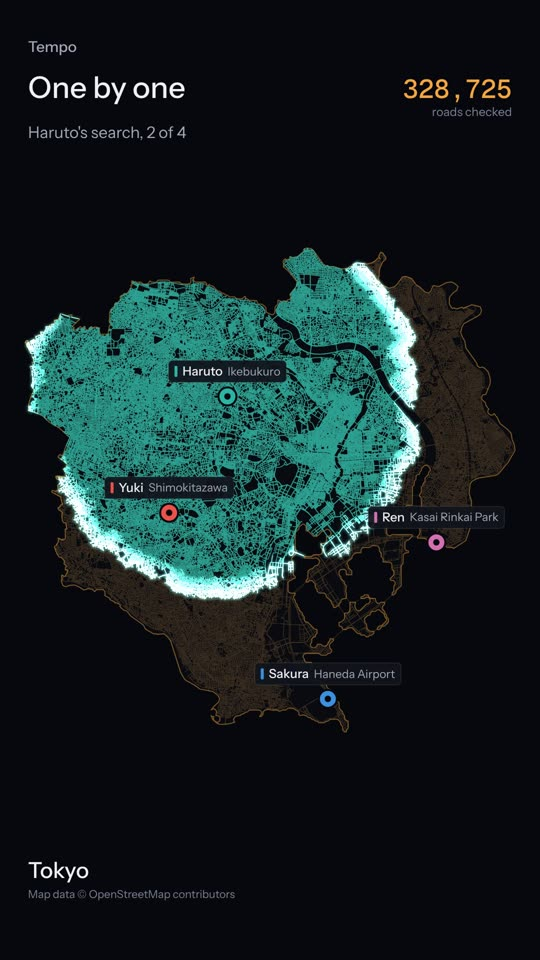
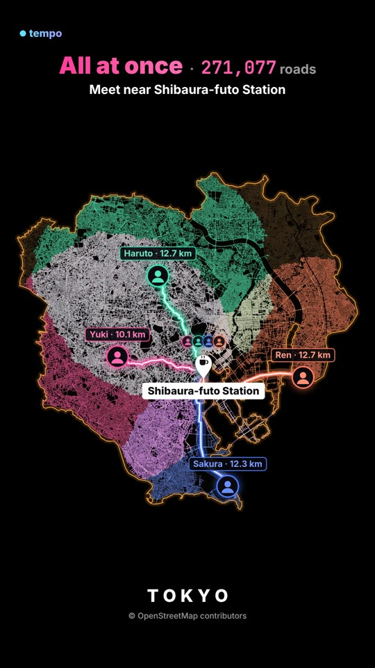

# Tempo

**Where should your friends meet?** Add where each friend is starting from. Tempo spreads out from each of them along real streets, finds the spot where the longest trip is as short as it can be, and suggests where to eat, what to do, what to see and where to sit back once you are there. The whole thing plays as a 9:16 animation you can record and share.

<p>
  
  
</p>

## How it works

1. **Starting points.** Type a neighbourhood, station or address for each friend, 2 to 12 of them. Places are found with Nominatim; if the first match is wrong, "Not this one" offers the others.
2. **The area.** If everyone is inside a bundled city (Tokyo's 23 wards), its streets load at once. If everyone is in the same city, its boundary is used. Otherwise Tempo downloads the streets in a box around everyone from the Overpass API, with more or less detail depending on the size.
3. **One by one.** A full Dijkstra search from each friend. Without knowing where everyone will end up, each search has to cover the whole map.
4. **All at once.** The searches take turns, always growing whichever front is closest. The first junction every flood reaches is where the longest trip is as short as possible, so the search stops there. In the Tokyo example that checks 64% fewer roads.
5. **Where to meet.** The searches carry on a little further to light up every street where nobody travels more than about 6% further (250 m to 1.5 km), so you can pick any spot in that zone. The centre is named after the closest station or park.
6. **Things to do.** Named places within a short walk come from OpenStreetMap in four groups: Eat, Activity, Sightseeing and Chill. They are ranked by walking distance along the streets, with a nudge towards well known places and bigger parks, and the top pick of each group appears in the video.

## Using it

- Drag a friend's marker on the map, or select their line colour in the list and click the map, to fine tune where they start.
- The timeline can be scrubbed and played at 0.5× to 2×, with or without the one-by-one phase.
- **Record video** saves a 1080 × 1920 MP4 or WebM.
- **Copy link** keeps the area and every starting point, so a shared link opens the same meetup.

## Running it

A static site with no build step and no dependencies.

```sh
npm start          # serves on http://localhost:8000 (or: python3 -m http.server)
npm test           # unit tests (Node 20+)
```

Any static host works, including GitHub Pages. Finding places and loading areas other than Tokyo needs the browser to reach `nominatim.openstreetmap.org` and the Overpass API.

## Code

| File | Purpose |
| --- | --- |
| `src/main.js` | App state, starting points, choosing the area, results, sharing and recording |
| `src/search.js` | Dijkstra, the simultaneous multi-source search with its meeting zone, and `Flood` replay data |
| `src/places.js` | The Overpass query for places, their four groups and ranking by walking distance |
| `src/graph.js` | Builds an intersection-to-intersection road graph from OSM ways, binary format, nearest-node grid |
| `src/renderer.js` | Canvas rendering: streets, floods, wavefronts, line-coloured routes, the meeting point and captions |
| `src/timeline.js` | The sequence of phases and what each frame shows |
| `src/geo.js` | Projection, simplification, point-in-polygon index, shore-hugging outline tracing |
| `src/osm.js` | Nominatim (one request a second, as its policy asks) and Overpass |
| `src/worker.js` | Downloads and builds new areas off the main thread |

## Design

The interface follows a "city transit map at night" direction: ink neutrals, streets in dim sodium amber, each friend a transit line colour, and the meeting point drawn as an interchange. Amber is kept for the few things that matter: the road count, the longest trip and the meeting zone. The visual pass followed [unslop](https://github.com/heydamir/unslop) by Damir Sokolovsky ([@heydamir](https://x.com/heydamir)), CC BY 4.0.

## Rebuilding or adding a bundled city

Presets are defined in `scripts/presets.json` (boundary relations, road detail, country and default friends). A preset ships its streets plus its own places and a list of stations, neighbourhoods and landmarks, so it works without OpenStreetMap's live services: Tokyo's things to do and meeting point names always come from the bundle, and starting points fall back to it when Nominatim cannot be reached.

```sh
pip install osmium shapely
# PBF extracts: https://download.openstreetmap.fr/extracts/ or https://download.geofabrik.de/
python3 scripts/extract_osm.py kanto.osm.pbf tokyo -o build/tokyo-osm.json
node scripts/build-preset.mjs build/tokyo-osm.json      # data/tokyo.tmpo and data/tokyo.json
python3 scripts/extract_places.py kanto.osm.pbf tokyo -o build/tokyo-places-osm.json
node scripts/build-places.mjs build/tokyo-places-osm.json tokyo   # data/tokyo-places.json.gz and data/tokyo-gazetteer.json.gz
```

To use a new preset, add it to `PRESETS` in `src/main.js`.

## Publishing as a claude.ai artifact

`node scripts/build-artifact.mjs` writes `build/artifact/index.html`, the page in the shape the artifact host expects, and `build/artifact/files.json`, the scripts and data to publish beside it. Artifact pages may not call other sites, so this build runs on the bundled Tokyo data only, hides the share link and saves recorded videos through the viewer's `downloads` capability.

## Data

Map data © [OpenStreetMap contributors](https://www.openstreetmap.org/copyright), available under the Open Database License. The files in `data/` are derived from it.
